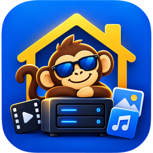
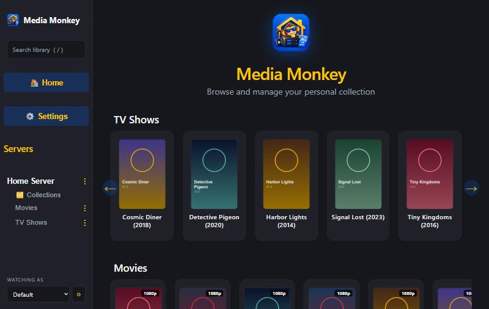
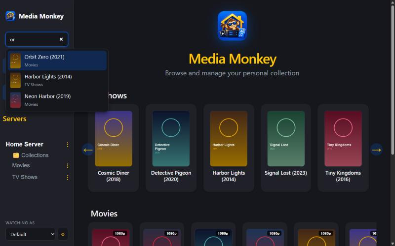
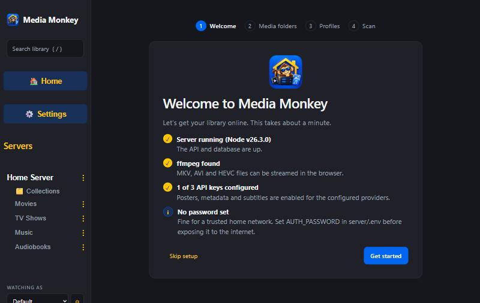
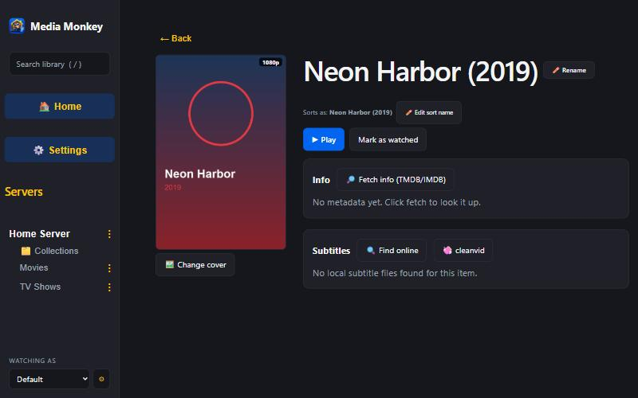
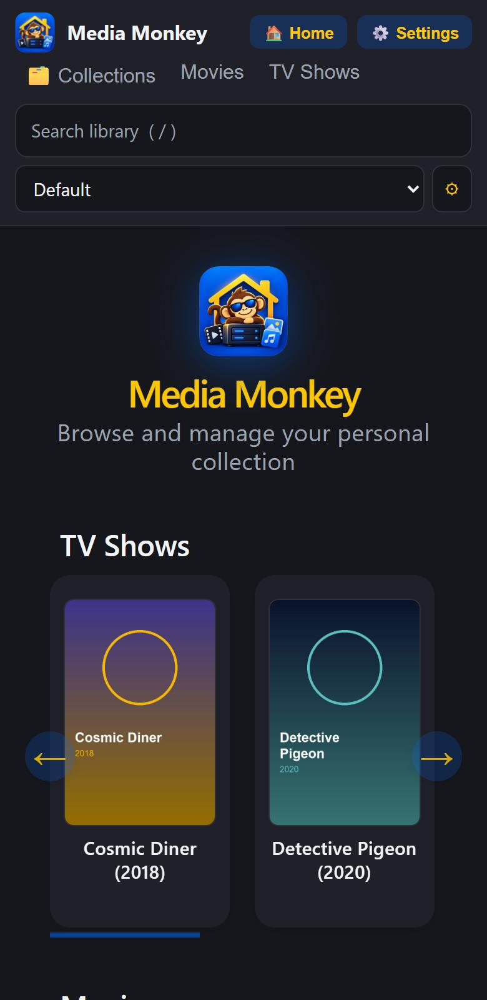

<p align="center">
  
</p>

<h1 align="center">Media Monkey</h1>

<p align="center">
  Self-hosted home media server: browse and stream your movies, TV shows, music and audiobooks from a clean web UI. Runs happily on a Raspberry Pi.
</p>

<p align="center">
  
</p>

<p align="center">
  
  
</p>

<p align="center">
  
  
</p>

*(Screenshots use a generated demo library.)*

## Features

- **First-run setup wizard**: system checks (ffmpeg, API keys, auth), folder picker, profiles and a first scan
- **Search**: instant title search across every folder and collection (press `/` to focus)
- **Profiles**: "who's watching?" switcher with separate watched marks and resume points per person, no passwords. Each profile can pick its own **colors** (defaults: `#0165f1` blue + `#fdc603` yellow)
- **Auto-scan**: background rescans pick up new/removed files, posters and subtitles. Unmounted drives are skipped, never wiped
- Library rows for TV, movies, music and audiobooks, plus user-defined **collections** that span folders
- Seasons/episodes, collection folders, per-item **sort-name** override (ignores leading "The/A/An")
- Playback with **Direct Play**, on-the-fly **remux** (mkv/avi → mp4) and **HLS transcode** (HEVC/AV1 → h264) via ffmpeg
- Metadata from **TMDB / OMDb** (single item or "Fetch all" with auto-apply + saved suggestions for review), posters saved to disk
- Subtitles: local `.srt`/`.vtt` (served as WebVTT) and **OpenSubtitles** search + download
- Cover upload with pan/zoom crop, rename item folders on disk, movie version picker
- Optional profanity filter via [cleanvid](https://github.com/mmguero/cleanvid)
- Optional password login (HMAC session cookie, login rate limiting) for public hosting
- Installable as a home-screen app (web manifest + icons), responsive layout, dark/light theme

## Requirements

- Node.js **24+** (uses the built-in `node:sqlite`)
- ffmpeg + ffprobe on `PATH` (only for non-MP4 streaming)

## Quick start

```bash
git clone https://github.com/webcooltz/media-monkey.git
cd media-monkey
npm run setup                      # install deps + build the client
cp server/.env.example server/.env # optional: API keys, password, ports
npm start                          # http://localhost:5000
```

On first run the setup wizard walks you through it. (You can also use **Settings**: point each folder at a directory on disk with **Browse…**, then save.) Folder names decide the category: a name containing `tv`, `movie`, `music` or `audiobook`.

### Development

```bash
npm run dev:server   # API on :5000 (nodemon)
npm run dev:client   # Vite on :5173, proxies /api and /media (set API_URL to change target)
npm run lint
npm test             # server tests (node:test, throwaway database per file)
```

### Docker

```bash
docker compose up -d --build
```

Mount your libraries read-only in `docker-compose.yml`, then use those container paths in Settings. A `/healthz` endpoint backs the container healthcheck.

## Configuration

All settings are environment variables, loaded from `server/.env` (see [`server/.env.example`](server/.env.example)).

| Variable | Default | Purpose |
| --- | --- | --- |
| `PORT` / `HOST` | `5000` / all | Listen port / bind address |
| `DB_PATH` | `server/data/media.db` | SQLite catalog location |
| `AUTO_SCAN_MINUTES` | `15` | Background rescan interval (`0` = off) |
| `AUTH_PASSWORD` | _(off)_ | Require login for all API + media routes |
| `SESSION_SECRET` | auto-generated | Fixed HMAC secret for sessions |
| `AUTH_COOKIE_SECURE` | `false` | Force `Secure` cookie (auto-detected behind HTTPS proxy) |
| `TRUST_PROXY` | `false` | Honour `X-Forwarded-*` behind a reverse proxy |
| `CORS_ORIGIN` | _(off)_ | Allow a separate client origin (dev only) |
| `TMDB_API_KEY`, `OMDB_API_KEY` | – | Metadata + posters |
| `OPENSUBTITLES_API_KEY`, `_USERNAME`, `_PASSWORD` | – | Subtitle search / download |
| `FFMPEG_CMD`, `FFPROBE_CMD`, `FFMPEG_HW_ENCODER` | `ffmpeg`, `ffprobe`, auto | Streaming tooling |
| `CLEANVID_ENABLED`, `CLEANVID_CMD` | `false`, `cleanvid` | Profanity filter |

**Security:** with no `AUTH_PASSWORD` the server is open to anyone who can reach the port (it logs a warning at startup). Set one before exposing it. See [HOSTING.md](HOSTING.md) for HTTPS, Cloudflare Tunnel and Raspberry Pi setup.

## Project layout

```
client/   React + TypeScript + Vite UI
server/   Express API, SQLite catalog (node:sqlite), scanner, streaming, metadata
docs/     README assets (logo, screenshots)
```
